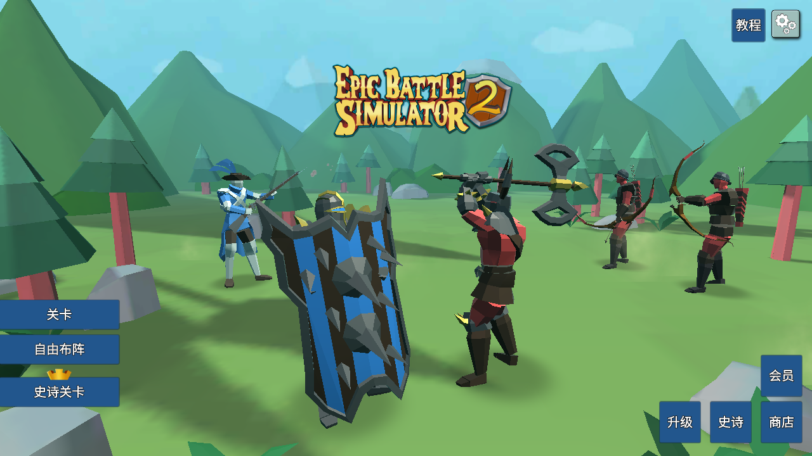
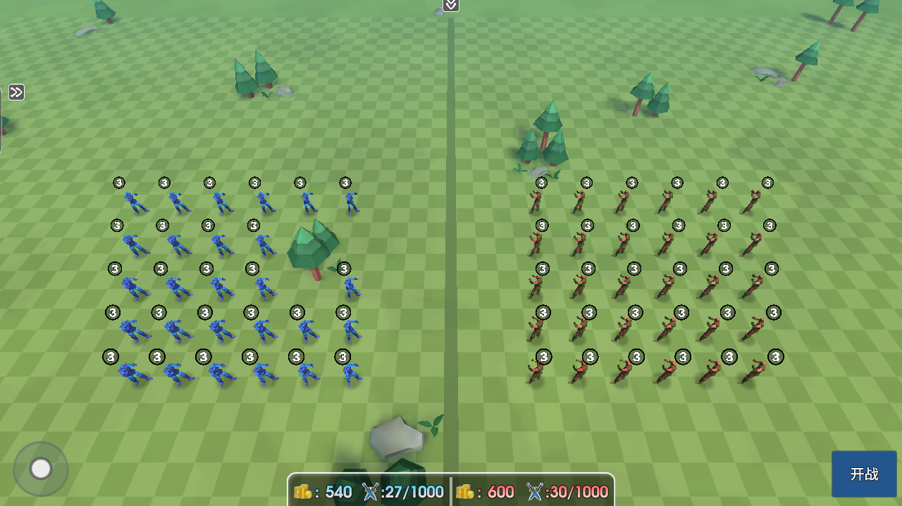
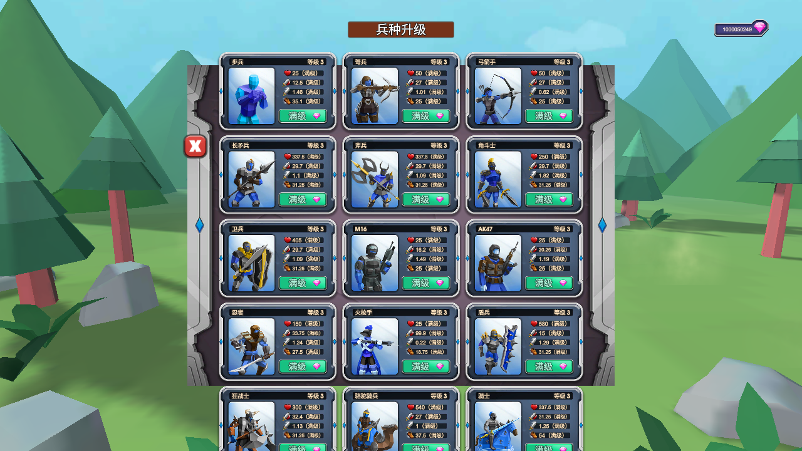

<h1 align="center">⚔️ EPIC BATTLE SANDBOX CN</h1>

  <strong>Choose your army. Shape the battlefield. Let the clash unfold.</strong>

  A browser-playable, single-player battle sandbox built on an existing Unity WebGL game, 
  with a partially localized Chinese interface, max-level troops, and generous resources.

  <a href="https://seiya058904.github.io/epic-battle-sandbox-cn/"><strong>▶ Play in Your Browser</strong></a>
  &nbsp;·&nbsp;
  <a href="#build-fight-repeat">🎮 How It Works</a>
  &nbsp;·&nbsp;
  <a href="#a-look-inside">🖼️ Screenshots</a>
  &nbsp;·&nbsp;
  <a href="#play-or-run-locally">⚙️ Run Locally</a>

  37 TROOP TYPES &nbsp;·&nbsp; LEVEL 3 ROSTER &nbsp;·&nbsp; AUTOMATED 3D BATTLES &nbsp;·&nbsp; BROWSER-LOCAL SAVES

  
  
  
  

  
   
  Actual Chromium gameplay capture. The game interface is partly Chinese; this README is written in English.

---

> **A formation is a question. The battle is how you test it.**
>
> Put a front line in place. Add ranged support. Try an unusual matchup. Start the simulation and watch the original 3D units move, collide, and fight. Then change the arrangement and see what happens next.
>
> This edition opens directly into its sandbox configuration. There is no extra mode switch above the game.

## 🎮 Build. Fight. Repeat.

<code>CHOOSE TROOPS &nbsp;→&nbsp; PLACE BOTH SIDES &nbsp;→&nbsp; START THE BATTLE &nbsp;→&nbsp; REVISE &amp; RETRY</code>

1. **Pick a mode.** Enter Custom Battle for your own matchup, or explore the build's regular and epic levels.
2. **Arrange the armies.** Select troops and click or tap the battlefield to place them within the permitted deployment areas.
3. **Watch the clash.** Start the battle and let the existing combat simulation resolve it. Pause and resume when you want a closer look.
4. **Try another idea.** Review the outcome, return to setup, and adjust your composition.

## ✨ More Room to Experiment

<table>
  <tr>
    <td width="50%" valign="top">
      <h3>🧩 A Ready-to-Use Roster</h3>
      
All 37 troop types are set to this build's highest level, Level 3. Eight epic troop types are available in the separate sandbox save.

    </td>
    <td width="50%" valign="top">
      <h3>💎 Generous Resources</h3>
      
Each launch seeds 999,999,999 gems. Spending still uses the game's real resource logic, and the upstream build may add its own starting bonus.

    </td>
  </tr>
  <tr>
    <td width="50%" valign="top">
      <h3>⚔️ Wider Deployment Budgets</h3>
      
Level budgets are expanded to 999,999,999 coins. Army and troop-type quotas are raised to 1,000, while terrain, collision and deployment-zone rules remain.

    </td>
    <td width="50%" valign="top">
      <h3>🈯 Native Chinese UI</h3>
      
Translated text and fonts live inside the Unity canvas. Common menu, deployment, pause and result buttons use real Chinese labels rather than webpage subtitles.

    </td>
  </tr>
  <tr>
    <td width="50%" valign="top">
      <h3>🌲 The Existing 3D Game</h3>
      
The original models, physics, touch interaction and automated combat remain in place. This is a modification of a compiled build, not a recreated look-alike.

    </td>
    <td width="50%" valign="top">
      <h3>💾 Separate Browser Saves</h3>
      
Sandbox and standard mode use different databases. The hosted game also uses project-specific names so it does not import another project's Unity save.

    </td>
  </tr>
</table>

The automatic advertising countdown is disabled. The original rating prompt may still appear. Resources are **large finite balances**, not mathematical infinity, and the 1,000-unit quota is **not a performance guarantee**.

## 🖼️ A Look Inside

<table>
  <tr>
    <td width="50%" align="center" valign="top">
      
       <strong>BUILD THE MATCHUP</strong> Place your forces before the simulation begins.
    </td>
    <td width="50%" align="center" valign="top">
      
       <strong>START WITH A FULL-LEVEL ROSTER</strong> Experiment with the build's existing troop progression.
    </td>
  </tr>
</table>

These are actual game captures, not concept art. Chinese localization is still partial: some product artwork, prompts and branding retain their original text.

## 🚀 Play or Run Locally

### 🌐 Play Online

**[Open Epic Battle Sandbox CN →](https://seiya058904.github.io/epic-battle-sandbox-cn/)**

The link loads the game itself. No game account or live game server is required. The first load downloads roughly **84 MiB** of runtime data, so allow a little time before the battlefield appears.

The game runs on your device. The hosted version needs a connection to fetch its files; a complete offline cache is not promised. Saves belong to the current browser and origin, and do not automatically transfer between GitHub Pages and localhost.

### 💻 Run the Packaged Build

Requires **Python 3** and a modern WebGL-capable browser. After cloning:

~~~bash
python tools/build_site.py
python -m http.server 8766 --bind 127.0.0.1 --directory output/pages
~~~

Open **http://127.0.0.1:8766/**.

The prepared runtime is included under `web-build/`. Rebuilding the underlying asset patches is a separate workflow; see the [local setup and recovery guide](README_LOCAL.md). An existing personal installation can continue using `Start-Local.ps1` at its original port, **8765**, without changing its saved profile.

### 🎛️ Controls at a Glance

| Action | Input |
| :--- | :--- |
| Select a troop or menu item | Click or tap |
| Place a unit | Click or tap a valid deployment position |
| Start combat | Use the battle button at the lower right |
| Pause / resume | Use the in-game pause and resume controls |
| Clear a formation | Open the deployment toolbar and use Clear |
| Use standard mode | Add `?sandbox=0` to the game URL |

Landscape orientation is recommended on a phone. Desktop and simulated touch viewports are covered by browser checks; physical Android-device validation is still pending.

## 🔎 What Has Been Verified

| Area | Evidence and limit |
| :--- | :--- |
| Native localization | 111 original-text mappings; 29 historically checked visually. A further 33 native labels were added, with 19 individually confirmed. This is not a whole-game coverage percentage. |
| Resource behavior | Three real upgrade deductions were verified in the earlier non-maxed test configuration. Current sandbox troops are already maxed; clicking a maxed button is not counted as spending. |
| Deployment budgets | A 15-Spartan deployment spent 10,500 coins against a former 6,000 budget. A custom formation reached 163 units against the former 120-unit limit. |
| Battle loop | Deployment, combat, pause, resume, result, refresh and reopening are exercised in Chromium. |
| Save boundaries | Local migration preserves source saves. Hosted sandbox and standard databases are separate from other projects' Unity databases. |
| Advertising countdown | The specific automatic countdown component is disabled; the earlier build was observed for 360 seconds. |

For the full audit, see [AUDIT.md](AUDIT.md) and the [evidence directory](evidence/). Some historical records are in Chinese. All levels, all devices and 1,000-unit battles have not been exhaustively tested.

<strong>🛠️ Development, verification and repository layout</strong>

### Checks

~~~bash
python tools/check_public.py
python -m unittest discover -s tools -p test_public.py -v
node tools/test_prefs.cjs
python tools/build_site.py
~~~

Browser checks require Python Playwright and an installed Chromium browser. Set `EBS_CHROMIUM` to its executable path when necessary:

~~~bash
python tools/test_hosted_storage.py
python tools/qa_playable_site.py http://127.0.0.1:8766/
python tools/qa_playable_site.py http://127.0.0.1:8766/ --mobile
~~~

### Repository Map

~~~text
site/                 Direct-to-game page and loading UI
web-build/            Approved, hash-locked WebGL runtime
docs/media/           Real gameplay screenshots
localization/         Translation tables and font license
tools/                Asset patching, packaging and verification
evidence/             Hash manifests and validation records
local-mode.js         Local and hosted save initialization
prefs-codec.js        PlayerPrefs codec and sandbox settings
~~~

The Pages workflow validates publication boundaries, builds `output/pages/`, and deploys that exact directory. Personal profiles, extracted analysis resources, original backups and old Git bundles remain excluded.

<strong>📜 Provenance and rights</strong>

This is an **unofficial modification** of the compiled WebGL build found in [CoreScripts/epicbattlesimulator2](https://github.com/CoreScripts/epicbattlesimulator2), pinned to commit `5b6e7f7`. It is not a Unity source project. Its title does not establish that it is the authorized Rappid Studios mobile release.

The maintainer confirmed permission to publicly deploy this modified build and distribute its required runtime assets. This confirmation is recorded in [NOTICE.md](NOTICE.md); it is not an open-source license for the underlying game. Game and brand rights remain with their respective owners. Noto font usage follows the included OFL terms.

No payment receipts, subscription flags, online balances, leaderboards or remote accounts are modified. Epic troops are available only within the independent sandbox state; this is not evidence of a real-money purchase.

---

  <a href="https://seiya058904.github.io/epic-battle-sandbox-cn/"><strong>Enter the battlefield →</strong></a>
   Make a formation. Watch it unfold. Try something different.

