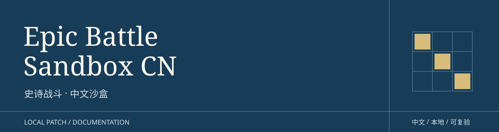

<div align="center">



**把中文界面、充足资源与自由布阵，带进个人本地沙盒。**

基于现有 Unity WebGL 编译构建的实验补丁 · 非官方项目

[](CHANGELOG.md)
[](localization/zh-CN.md)
[](README_LOCAL.md)
[](https://github.com/seiya058904/epic-battle-sandbox-cn/actions/workflows/pages.yml)

[项目网站](https://seiya058904.github.io/epic-battle-sandbox-cn/) · [本地运行](README_LOCAL.md) · [验收记录](AUDIT.md) · [汉化对照](localization/zh-CN.md)

</div>

---

## 从游戏本身出发

保留现有 3D 场景、物理和自动战斗，在可验证的资源对象与独立存档上修改。中文标签进入 **Unity Canvas**；资源写入实际 **PlayerPrefs**。打开本地入口就进入当前沙盒配置，没有额外的模式按钮。

本仓库只发布补丁代码、翻译表、测试和文档。**网站是项目介绍，不提供在线游戏或游戏资产下载。** 运行需要自行准备有权使用、且 SHA-256 与基线一致的原始构建。

## 已经做到什么

| 能力 | 当前实现 | 验证边界 |
| :--- | :--- | :--- |
| 游戏内中文 | 111 个原文映射；另增 33 处原生按钮与标题 | 历史映射目视确认 29 项，新标签确认 19/33 处；不等于全汉化 |
| 充足宝石 | 每次启动补充到 `999999999`，正常消费、保存 | 历史完成 3 次真实升级扣费；不是永不减少的余额 |
| 兵种与等级 | 37 种兵种设为本构建最高 3 级；8 种史诗兵种在本地模拟档可用 | 不伪造付款、订阅或服务器权限 |
| 宽松布阵 | 关卡金币 `999999999`，人数与每类配额提高到 `1000` | 实测 163 人布阵；地形、碰撞及性能限制仍存在 |
| 安静试玩 | 停用自动广告倒计时组件，移除网页顶部控制栏 | 连续观察 360 秒未出现该倒计时；评分提示仍可能出现 |
| 存档隔离 | 普通档、旧沙盒、新沙盒分开 | 已验证刷新、重开及普通档隔离；不覆盖个人存档 |

桌面与模拟 Android 触屏视口已完成布阵、开战、暂停、继续和结算验证。真实 Android 设备、全部关卡及 1000 人压力测试未完成。完整证据与例外以 [AUDIT.md](AUDIT.md) 为准。

## 在本地开始

**已整理好的这台电脑**：在项目目录执行：

```powershell
./Start-Local.ps1
```

固定入口为 `http://127.0.0.1:8765/local.html`。不要改端口或换成 `localhost`，以免进入另一份浏览器存储。

**从 GitHub 新克隆**：仓库不包含游戏资产，先按 [完整运行指南](README_LOCAL.md) 导入获授权原件、准备字体并重建三个补丁阶段，再运行启动器。

## 找到你需要的内容

```text
epic-battle-sandbox-cn/
├── README_LOCAL.md       本地运行、重建与恢复
├── AUDIT.md              实际验收结果与局限
├── CHANGELOG.md          版本变化
├── NOTICE.md             第三方来源与发布范围
├── local.html            本地游戏入口
├── local-mode.js         独立存档初始化
├── prefs-codec.js        PlayerPrefs 编解码与沙盒值
├── localization/         翻译表、汉化对照与字体许可
├── tools/                构建、检查与浏览器复验
├── evidence/             文本证据及 SHA-256 清单
└── site/                 独立项目介绍网站
```

游戏原件 `Build/`、生成包 `local-generated/`、截图 `output/` 和仓库外的个人浏览器配置均留在本机，不进入 Git 历史。公开仓库从干净历史建立，旧历史只保存在本地恢复包中。

## 验证与恢复

```powershell
python tools/check_public.py
node tools/test_prefs.cjs
python tools/verify_originals.py   # 需要本地原件和备份
```

普通模式使用 `local.html?sandbox=0`；原始构建使用同一 origin 的 `index.html`。具体恢复流程及旧历史恢复方法见 [README_LOCAL.md](README_LOCAL.md#恢复与回滚)。

## 来源与边界

分析基线来自 [CoreScripts/epicbattlesimulator2](https://github.com/CoreScripts/epicbattlesimulator2)，锁定提交 `5b6e7f7`。仓库名不能证明它是 Rappid Studios 的授权原版；本项目也不声称第三方游戏本体开源。

仅面向个人本地单机实验，不操作在线账户、排行榜、服务端余额或真实支付。游戏和品牌权利归相应权利人；Noto 字体使用 OFL。详见 [NOTICE.md](NOTICE.md)。
